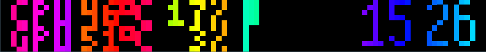

# NexTuxLinq

Open-source Linux control software for the Phanteks Matrix900 display.

!!! Fully written via ChatGPT 5.6 Sol + Codex !!!

## Project scope

This project currently targets only the Phanteks Matrix900.

The following hardware is not currently supported or tested:

- Phanteks Matrix600
- Phanteks fans and fan controllers
- Other NexLinq hubs, displays, and accessories

Compatibility with untested devices must not be assumed. Support for additional hardware may be added in the future if contributors can provide hardware access, USB captures, and testing.

## Status

This project is in an early reverse-engineering stage. Matrix900 device
control, a local daemon, and a loopback-only web GUI are implemented, while
many protocol features remain capture-driven or intentionally limited.

Currently identified hardware:

- Device: Phanteks Matrix900
- USB vendor ID: `2e3c`
- USB product ID: `6500`
- Interface: vendor-defined USB HID
- HID report ID: `0x01`
- HID report size: 64 bytes including the report ID
- USB OUT endpoint: `0x01`
- USB IN endpoint: `0x82`

## Goals

- Detect connected Matrix900 devices
- Control the display without root privileges
- Reverse-engineer and document the USB protocol
- Provide a command-line interface
- Support brightness, text, images, layouts, animations, and system telemetry
- Package the software for Arch Linux and CachyOS

## Safety

Unknown commands are not sent to the device.

Firmware updates, bootloader access, and other potentially destructive operations are out of scope until the protocol is fully understood.

## License

MIT

## Trademark notice

Phanteks and NexLinq are trademarks of their respective owners. NexTuxLinq is
an independent community project and is not affiliated with or endorsed by
Phanteks.

## Current Linux control support

The Linux implementation can currently:

- Detect connected Phanteks Matrix900 devices through `hidraw`.
- Set brightness from 10% through 100% in ten-percent steps.
- Read and display the Matrix900 response report.

The tracked Matrix900 permission rule is `udev/70-nextuxlinq.rules`. This
repository rename does not install or modify rules on the running system.

Examples:

```console
nextuxlinqctl detect
nextuxlinqctl brightness 50
```

### Local controller service and GUI

Install the Matrix900 controller as a systemd user service:

```console
nextuxlinqctl service install
```

It starts automatically after login and serves the loopback-only GUI at
<http://127.0.0.1:8765>. Installation stops and disables old NexLinq and
NexTuxLinq display/telemetry helpers so `nextuxlinqd` is the sole project
writer.

The GUI provides a visual 90×10 free-layout editor for canonical schema-v2
profiles. Regions can be added, moved, resized, reordered, and assigned one of
eight widgets, including live System Metric text, Metric Bars, and a native
Built-in Icon. **Apply**
validates and updates the running profile, while
**Save applied configuration** persists only the already-applied state.
Browser drafts and revision conflicts remain explicit. The editor and preview
use viewer perspective (Rear left, Front right), while stored integer
coordinates and glyph pixels remain logical and unmirrored. See
[`docs/free-layout-editor.md`](docs/free-layout-editor.md). Profile presets,
JSON import/export, and managed backups are documented in
[`docs/profile-management.md`](docs/profile-management.md). Linux metric
sources and formatting are documented in
[`docs/system-metrics.md`](docs/system-metrics.md). The Profile section appears
below the physical display preview so the editor and preview remain the primary
workflow.

Profiles may enable a global **Foreground Rainbow** effect that recolors only
semantic widget foreground pixels while preserving canvas and region
backgrounds and empty Metric Bar pixels. Its backend-rendered color field is
continuous across all 90 physical columns, supports Rear → Front and Front →
Rear travel, and uses cycles per second; speed zero is static. Widget colors
remain stored and return when the effect is disabled. Animated effects use the
existing continuous scheduler and the preview and Matrix900 derive from the
same framebuffer. See [`docs/display-effects.md`](docs/display-effects.md).

### Showcase



Example of a rendered NexTuxLinq layout using the global Foreground Rainbow
effect.

Text widgets use immutable native 3×5, 3×7, 5×7, 4×9, 5×9, and 5×10 bitmap
fonts. Auto selects the largest fitting native fixture from backend metadata;
a 25×10 `HH:MM` Clock resolves to the true 5×10 font without scaling.

The initial Built-in Icon is a checked-in, unscaled 15×10 CachyOS logo. Its
active pixels always use CachyOS Turquoise (`#1DC7B5`), transparent pixels keep
the region background, and display effects do not recolor it. This pixel
adaptation does not claim CachyOS affiliation or endorsement. The Selected
region inspector also includes a backend-rendered Content preview for every
widget, including undersized drafts; its quick actions change only the local
draft and previewing never applies, saves, persists, or uploads a frame.

Live telemetry includes CPU, memory, uptime, load, fixed-root storage, network
rates, and generic kernel-exposed GPU, VRAM, and temperature data. Sensor
availability varies by hardware and driver; no vendor utility, shell command,
fan control, or OpenLinkHub control is used. Sanitized availability diagnostics
are shown under Technical details. The preset library also includes Extended
System Monitor and Temperature Monitor layouts.

Install and uninstall operations use a private, non-blocking manager lock.
Replaced or uninstalled managed units are retained as private `.bak` files
beside the user unit; systemd does not recognize these backups, and NexTuxLinq
never deletes them automatically.

Control or inspect the service with:

```console
nextuxlinqctl service start
nextuxlinqctl service stop
nextuxlinqctl service restart
nextuxlinqctl service enable
nextuxlinqctl service disable
nextuxlinqctl service status
nextuxlinqctl service logs
journalctl --user -u nextuxlinqd.service -n 100 --no-pager
journalctl --user -u nextuxlinqd.service -f
```

For systems affected by a shared USB/controller hand-off issue, NexTuxLinq can
optionally install a post-start drop-in that waits two seconds and
`try-restart`s an already-active `OpenLinkHub.service`. It is disabled by
default, does not affect manual daemon starts, and is documented with its
enable, disable, and status commands in [`docs/systemd.md`](docs/systemd.md).
It remains optional project functionality and must be enabled explicitly.
OpenLinkHub is restarted only when already active, and failure is nonfatal.
This does not add Corsair fan or RGB control.

After autostart is configured, direct `nextuxlinqd` execution is reserved for
development while the user service is stopped. The application lock rejects a
manual and managed daemon running together. Startup before login may require
optional systemd user lingering; NexTuxLinq never enables lingering itself.

Uninstalling preserves all configuration and profiles, reports the retained
disabled-unit backup, and does not re-enable legacy helpers:

```console
nextuxlinqctl service uninstall
```

See [`docs/systemd.md`](docs/systemd.md) for installation safety and migration
details. This is a user-service integration, not a distro package or public
installer.

Frontend state tests use the built-in `node:test` runner and require Node.js
20 or newer when running the development test suite. Node.js is not a runtime
dependency of NexTuxLinq or its packaged GUI.

### Linux telemetry

Send one hardware telemetry update:

```console
nextuxlinqctl telemetry
```

Continuously update the display once per second:

```console
nextuxlinqctl telemetry --watch
```

The initial Linux sensor mapping uses:

- CPU temperature: `k10temp` / `Tctl`
- GPU temperature: `amdgpu` / `edge`
- Fan or pump speed: highest RPM reported by `nct6798`

This mapping is currently hardware-specific and will become configurable.

### System Data widget source

Configure the verified fullscreen System Data variant:

```console
nextuxlinqctl system-data cpu
nextuxlinqctl system-data gpu
nextuxlinqctl system-data fan
```

This command currently uses user-facing layout 12, internal layout ID `0x01`.
The CPU, GPU, and FAN source identifiers are verified from Windows captures.

### Fullscreen free text

Display ASCII text using the captured fullscreen Time and Date widget:

```console
nextuxlinqctl text "NEXTUXLINQ"
```

The current encoder supports up to 49 ASCII bytes.
Unicode encoding and the exact maximum firmware length are not yet verified.

### Fullscreen digital clock

Display the captured fullscreen digital-clock configuration:

```console
nextuxlinqctl clock
```

The background telemetry service supplies the current Unix timestamp.
Clock option fields such as timezone, position, colors, and 12/24-hour mode
are currently preserved as an exact captured profile.

### Fullscreen Time and Date widgets

Display the verified captured profiles:

```console
nextuxlinqctl time-widget digital
nextuxlinqctl time-widget graphical
nextuxlinqctl time-widget date
nextuxlinqctl time-widget week
```

`nextuxlinqctl clock` remains available as an alias for the digital clock.
The captured digital profile displays local time using the 24-hour format.

### Two-slot clock and System Data layout

Display a digital clock beside a live System Data widget:

```console
nextuxlinqctl layout-clock-system cpu
nextuxlinqctl layout-clock-system gpu
nextuxlinqctl layout-clock-system fan
```

This preset uses user-facing layout 1, internal layout ID `0x02`.

### Generic multi-slot layouts

Configure a user-facing NexLinq layout by supplying exactly one widget for
every slot, in visual slot order:

```console
nextuxlinqctl layout 1 digital system-gpu
nextuxlinqctl layout 2 digital system-cpu system-gpu
nextuxlinqctl layout 3 digital date system-cpu system-gpu
```

Currently supported slot widgets:

- `digital`
- `graphical`
- `date`
- `week`
- `system-cpu`
- `system-gpu`
- `system-fan`

Layout geometry and slot counts are verified from the Windows layout capture.
Not every possible widget and layout combination has been validated on hardware.

### Fullscreen System Data profiles

Display the captured System Data widgets:

```console
nextuxlinqctl system-widget variant1-cpu
nextuxlinqctl system-widget variant1-gpu
nextuxlinqctl system-widget variant1-fan
nextuxlinqctl system-widget variant2
nextuxlinqctl system-widget variant3
nextuxlinqctl system-widget overview
nextuxlinqctl system-widget aio-pump
nextuxlinqctl system-widget graph-cpu
nextuxlinqctl system-widget graph-gpu
```

The fixed profiles reproduce exact Windows capture reports.
Source selection has only been verified for System Data variant one.


### Single-source System Data graph

Display an animated graph for one selected temperature source:

```console
nextuxlinqctl system-widget graph-cpu
nextuxlinqctl system-widget graph-gpu
```

The same widgets can be used in generic layouts as `system-graph-cpu` and
`system-graph-gpu`. CPU and GPU are hardware-verified. FAN is not yet verified
for this widget.


### Single-value System Data bars

Display one live CPU or GPU value using the verified bar profiles:

```console
nextuxlinqctl system-widget bar-cpu
nextuxlinqctl system-widget bar-gpu
nextuxlinqctl system-widget background-bar-cpu
nextuxlinqctl system-widget background-bar-gpu
```

The equivalent generic-layout names are:

- `system-bar-cpu`
- `system-bar-gpu`
- `system-background-bar-cpu`
- `system-background-bar-gpu`

The legacy names `variant2` and `variant3` remain CPU-profile aliases.
FAN source selection is not yet verified for these widgets.


### FAN source support

The following fullscreen FAN profiles are hardware-verified:

```console
nextuxlinqctl system-widget variant1-fan
nextuxlinqctl system-widget background-bar-fan
```

The generic-layout name for the second profile is
`system-background-bar-fan`.

FAN is not supported by the regular value bar or the animated single-source
graph. The Matrix900 falls back to an incomplete CPU display for those
combinations.

### RPM telemetry sources

The telemetry command supports two explicit RPM sources:

```console
nextuxlinqctl telemetry --rpm-source fan
nextuxlinqctl telemetry --rpm-source pump
```

- `fan` reads all active non-AIO fans from OpenLinkHub and sends their rounded
  average RPM. This is the default.
- `pump` reads the highest RPM value from the `nct6798` hwmon chip.

The Matrix900 protocol currently exposes one verified RPM telemetry field, so
fan and pump RPM cannot yet be transmitted simultaneously.
